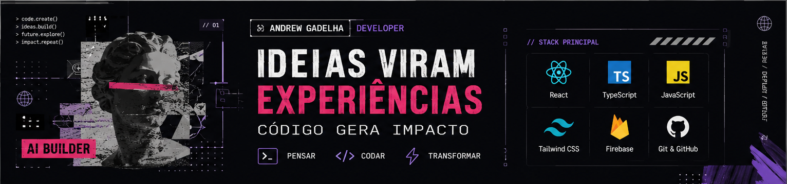

  

  <a href="https://www.andrewgadelha.com/">PORTFÓLIO</a>
  &nbsp;·&nbsp;
  <a href="https://www.linkedin.com/in/andrewgadelha/">LINKEDIN</a>
  &nbsp;·&nbsp;
  <a href="https://github.com/andrewgadelha">GITHUB</a>

  <strong>DESENVOLVIMENTO DE SOFTWARE</strong>
  &nbsp; / &nbsp; FRONT-END
  &nbsp; / &nbsp; EXPERIMENTAÇÃO

---

## 01 / SOBRE

Sou desenvolvedor de software, formado em **Análise e Desenvolvimento de Sistemas pela FATEC São Caetano do Sul**. Meu foco profissional está no desenvolvimento Front-End, principalmente com **JavaScript, TypeScript e React**.

Gosto de partir de uma ideia, explorar possibilidades e transformar o conceito em uma experiência digital funcional. O que mais me motiva é o próprio ciclo de criação: **imaginar, experimentar, construir, testar e ajustar** até a ideia ganhar forma.

Tenho curiosidade por novas tecnologias e interesse em entender as soluções — não apenas utilizá-las. Quero construir uma base técnica sólida sem perder a liberdade de explorar ferramentas, abordagens e caminhos diferentes.

## 02 / COMO EU PENSO E CONSTRUO

- **Ideia antes da ferramenta.** Entender o que quero criar vem antes de escolher como construir.
- **Experimentação faz parte do processo.** Testar possibilidades, avaliar resultados e ajustar a direção são etapas da criação.
- **Tecnologia como meio.** Desenvolvimento de software é uma forma de transformar conceitos em produtos e experiências digitais.
- **IA como amplificadora.** Tenho interesse em usar inteligência artificial para estruturar ideias, apoiar a implementação e executar testes — mantendo comigo as decisões e a avaliação do resultado.

## 03 / TECNOLOGIAS

**Foco profissional**  
`JavaScript` · `TypeScript` · `React`

**Interfaces e prototipação**  
`Tailwind CSS` · `Figma` · `Bubble.io`

**Dados e serviços**  
`Firebase` · `Supabase` · `MySQL` · `MongoDB`

**Outras tecnologias exploradas**  
`React Native` · `Node.js` · `PHP` · `Java`

## 04 / TRABALHOS EM DESTAQUE

<table>
  <tr>
    <td width="50%" valign="top">
      <strong><a href="https://github.com/andrewgadelha/porfolio">PORTFÓLIO</a></strong> 
      Repositório do meu site pessoal, desenvolvido com TypeScript. Uma apresentação do meu trabalho, interesses e trajetória.  
      TypeScript · <a href="https://www.andrewgadelha.com/">visitar site</a>
    </td>
    <td width="50%" valign="top">
      <strong><a href="https://github.com/andrewgadelha/todolist">TO DO LIST</a></strong> 
      Aplicação de lista de tarefas desenvolvida com React e TypeScript, estilizada com Tailwind CSS e integrada ao Firebase.  
      React · TypeScript · Tailwind CSS · Firebase
    </td>
  </tr>
</table>

## 05 / ESTUDOS & EXPERIMENTOS

Além dos projetos principais, uso repositórios para registrar estudos, testar abordagens e explorar ideias:

- **[Meus Desafios Criativos](https://github.com/andrewgadelha/meus-desafios-criativos)** — experimentos de ideação e propostas de solução com apoio de prompts e LLMs.
- **[Python: Introdução a Agentes de IA](https://github.com/andrewgadelha/python-introducao-agentes-ia)** — exercícios introdutórios de Python realizados no bootcamp Bradesco — Agentes de IA.

## 06 / FORMAÇÃO

**Análise e Desenvolvimento de Sistemas**  
FATEC São Caetano do Sul · Concluído em 2023.

## 07 / EM MOVIMENTO

Busco uma oportunidade de início de carreira em **desenvolvimento Front-End**. Quero contribuir na construção de interfaces e produtos digitais, aprender com problemas reais e ampliar minha capacidade de transformar ideias em software.

  <strong>UMA IDEIA É O PONTO DE PARTIDA. O RESTO É EXPLORAÇÃO.</strong> 
  <a href="https://www.andrewgadelha.com/">andrewgadelha.com</a>
  &nbsp;·&nbsp;
  <a href="https://www.linkedin.com/in/andrewgadelha/">Vamos conversar no LinkedIn</a>

